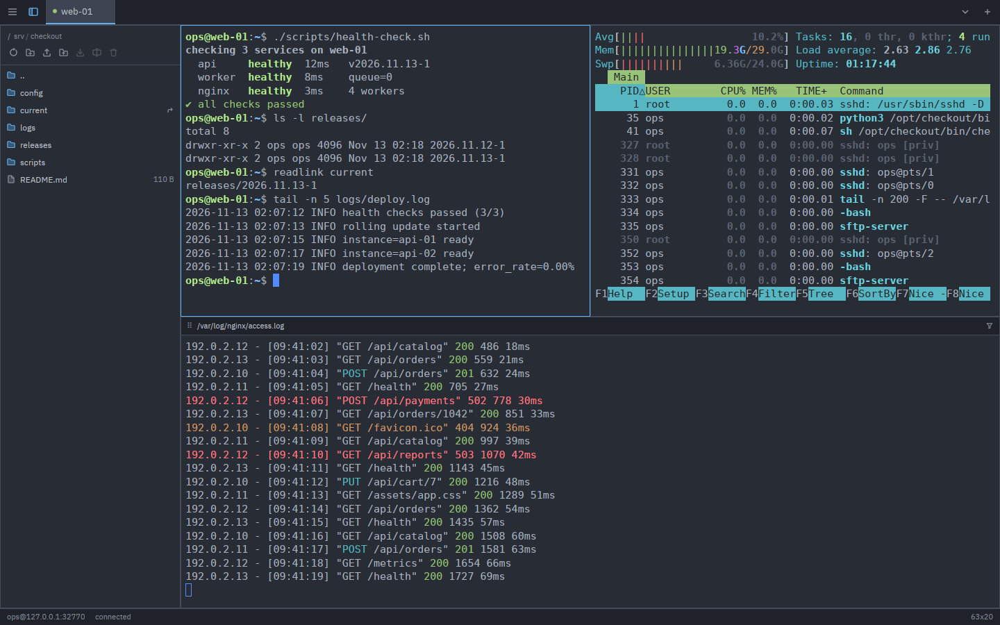
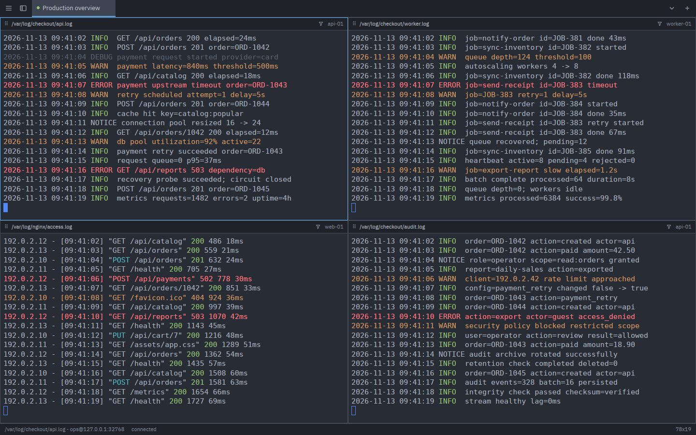
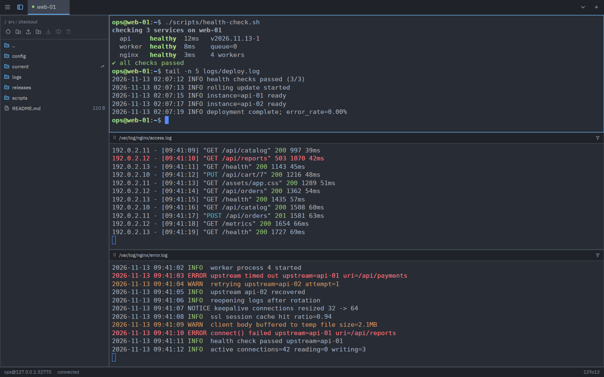
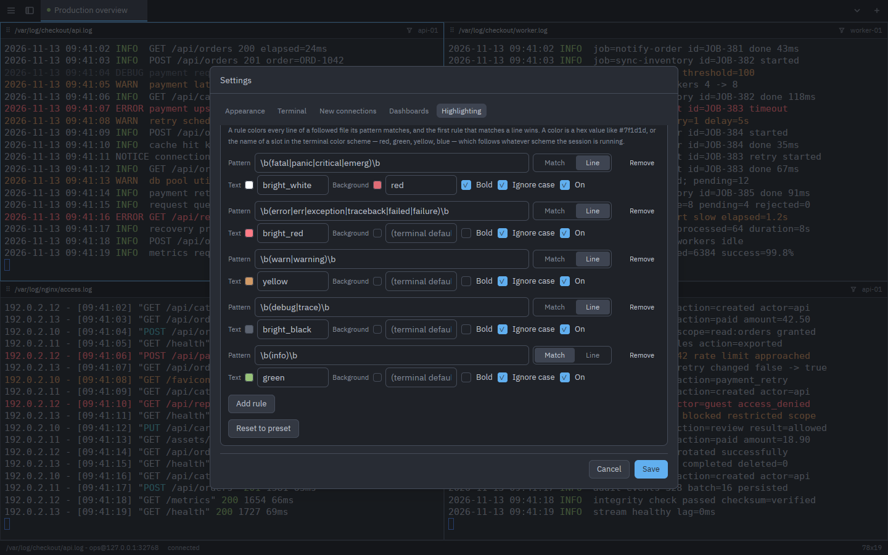
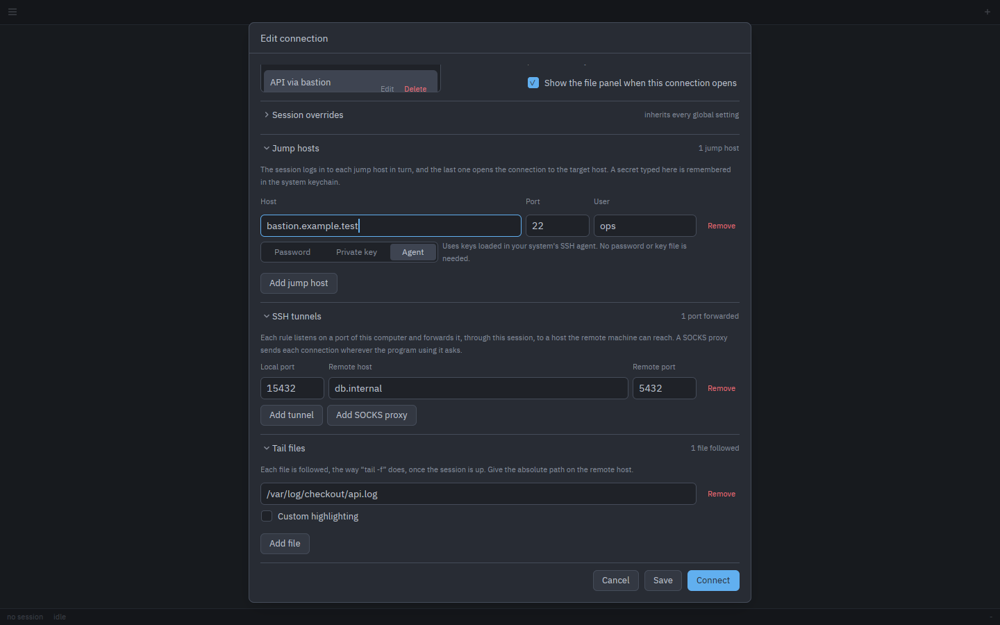
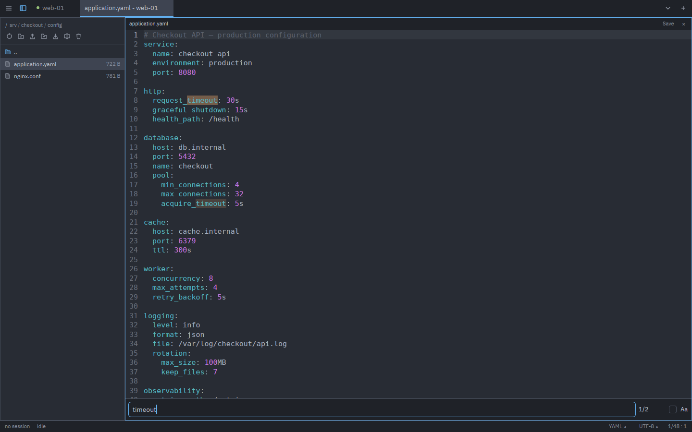
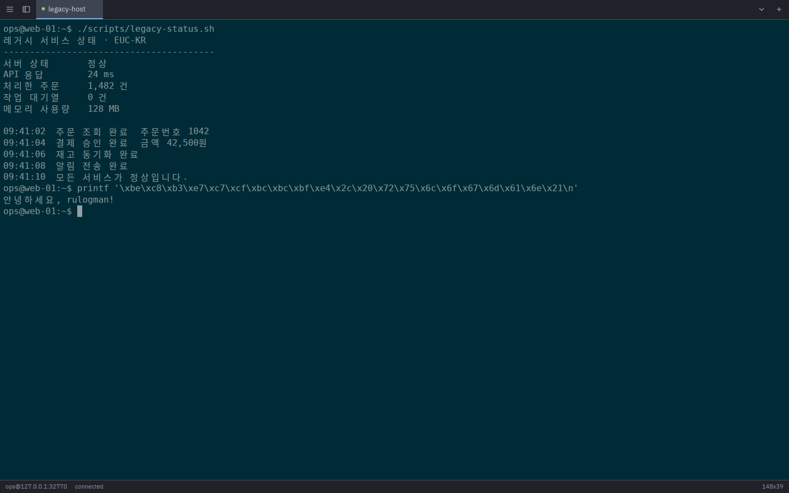
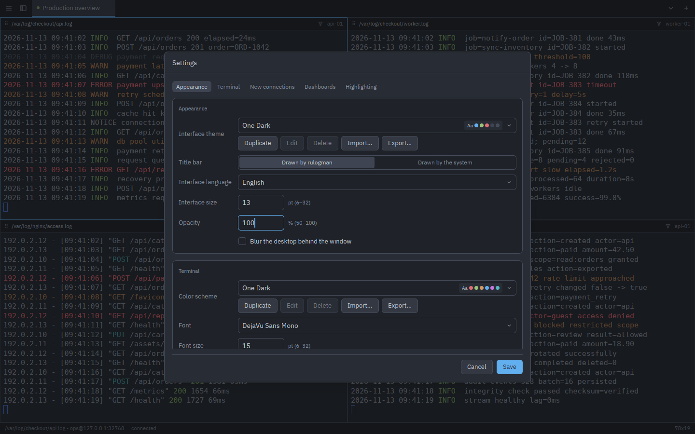

#  rulogman

[](https://github.com/xcomart/rulogman/actions/workflows/ci.yml)
[](https://github.com/xcomart/rulogman/releases)
[](LICENSE)

[](https://xcomart.github.io/rulogman/)

A multi-platform GUI SSH terminal written in Rust, built on
[gpui](https://gpui.rs) — the GPU-accelerated UI framework behind the Zed editor.





<details>
<summary>Follow two logs beside an SSH shell, with SFTP files at hand</summary>



</details>

<details>
<summary>Highlight matched text or whole log lines with regular expressions</summary>



</details>

<details>
<summary>Bastions, port forwards and followed files in one connection profile</summary>



</details>

<details>
<summary>Edit remote files in a tab of their own</summary>



</details>

<details>
<summary>A host that speaks EUC-KR: raw bytes in, Korean on the grid</summary>



</details>

<details>
<summary>Choose UI and terminal palettes independently</summary>



</details>

## What it does

Every screen, setting and shortcut is covered in the [user guide](docs/user-guide.md).

- **[Profiles](docs/user-guide.md#getting-started)** — password, private-key or SSH Agent logins, grouped in folders, importable from `~/.ssh/config`.
- **[Local shells](docs/user-guide.md#a-shell-on-this-computer)** — your login shell, PowerShell, `cmd` or a WSL distribution in a tab of its own.
- **[Tabs and split panes](docs/user-guide.md#tabs-and-sessions)** — one session per tab; a split opens in the directory the shell is in.
- **[Followed files](docs/user-guide.md#followed-files)** — `tail -F` panes under the shell that keep flowing through log rotation.
- **[Highlighting and filtering](docs/user-guide.md#highlighting-a-followed-file)** — regex rules color matches or whole lines, and a filter keeps or hides lines.
- **[Port forwarding](docs/user-guide.md#port-forwarding)** — local and SOCKS forwards saved with the profile.
- **[Jump hosts](docs/user-guide.md#jump-hosts)** — bastion chains dialed like `ssh -J`, each hop with its own login.
- **[Dashboards](docs/user-guide.md#dashboards)** — followed files from many servers in one grid, opened in one click.
- **[Session overrides](docs/user-guide.md#session-overrides)** — color scheme, font size, scrollback, `TERM` and character set per host.
- **[Files panel](docs/user-guide.md#the-files-panel)** — SFTP or local files beside the terminal, following the shell's `cd`.
- **[Editor](docs/user-guide.md#the-editor)** — remote files in a tab, with syntax highlighting for twenty formats and legacy character sets.
- **[A real terminal](docs/user-guide.md#the-terminal)** — `alacritty_terminal` emulation, so vim, tmux and htop behave as usual.
- **[Themes and color schemes](docs/user-guide.md#themes-and-color-schemes)** — picked separately; Windows Terminal scheme files work as they are.
- **[Settings](docs/user-guide.md#settings)** — eight interface languages, installed fonts, opacity and blur, in a hand-editable `settings.json`.
- **[Keyboard shortcuts](docs/user-guide.md#keyboard-shortcuts)** — for every command, chosen to stay out of the remote shell's way.
- **[Host keys and secrets](docs/user-guide.md#data-and-security)** — trust-on-first-use host keys; passwords only in the OS credential store.
- **[Self-update](docs/user-guide.md#updating)** — downloads and verifies the new release, then restarts into it.

## Installing

Prebuilt binaries for Windows, macOS and Linux, each for x86-64 and for
ARM64 (Apple Silicon on the Mac), are attached to every
[GitHub release](https://github.com/xcomart/rulogman/releases). The
asset names carry the target: `x86_64` or `aarch64`, then
`unknown-linux-gnu`, `pc-windows-msvc` or `apple-darwin`.

### Linux

The Linux archive holds the binary, a desktop entry, icons and an `install.sh`
that puts them under `~/.local` for the current user — no root needed. Take
the `x86_64` or the `aarch64` one, whichever `uname -m` names:

```bash
tar xzf rulogman-v<version>-x86_64-unknown-linux-gnu.tar.gz
cd rulogman-v<version>-x86_64-unknown-linux-gnu
./install.sh
```

The binary needs glibc 2.35 or newer: Ubuntu 22.04, Debian 12 and later, or a
distribution built on them, MX Linux 23 among them.

The binary lands in `~/.local/bin/rulogman`; the desktop entry is written with
that absolute path, so the launcher in your application menu works whether or
not `~/.local/bin` is on your `PATH` (add it if you want to start rulogman from
a shell too).

xkbcommon, keyboard handling included, is built into the binary, so what the
program needs from the system is what a desktop install already has: glibc
2.35, libxcb, an EGL or Vulkan loader and, in a Wayland session, the Wayland
client library. `install.sh` checks for them when it runs and prints the
command that installs whatever is missing.

#### AppImage

Each release also carries an AppImage,
`rulogman-v<version>-<arch>-unknown-linux-gnu.AppImage`: the same program in
one file that runs where it is, with nothing to install:

```bash
chmod +x rulogman-v<version>-x86_64-unknown-linux-gnu.AppImage
./rulogman-v<version>-x86_64-unknown-linux-gnu.AppImage
```

It needs the same glibc and system libraries as the archive, plus FUSE to
mount itself: the `fuse3` package, which desktop
installs of those distributions include. Without FUSE, start it with
`--appimage-extract-and-run`. The image adds no launcher to the application
menu; a tool such as Gear Lever or AppImageLauncher does that. When rulogman
updates itself it replaces the AppImage file, so keep the file somewhere you
can write to.

### Windows

rulogman is in the Windows Package Manager, so on Windows 10 and 11 one
command installs it:

```powershell
winget install Xcomart.Rulogman
```

winget downloads the setup installer from the GitHub release, checks it against
the SHA256 recorded in its manifest and installs it for the current user, the
same per-user install the installer does on its own, and on ARM64 Windows it
picks the native ARM64 build. A new release reaches
winget once its manifest is merged into
[microsoft/winget-pkgs](https://github.com/microsoft/winget-pkgs), so it can
trail the GitHub release by a day or two.

The installer and the zip archive can also be downloaded from the release page
directly, as `x86_64-pc-windows-msvc` for x64 PCs and `aarch64-pc-windows-msvc`
for ARM64 ones (the x64 build runs there too, emulated). The next section
covers the warning such a download meets on its first launch.

### Windows warns before the first launch

The Windows executable and the installer built around it are
Authenticode-signed, but with a self-signed certificate: there is no
certificate from a commercial authority behind the project, and SmartScreen
judges a publisher by reputation rather than by signature. So the first launch
of a fresh download is met with **"Windows protected your PC"** and a
publisher of *Unknown*. The signature is a tamper seal, not a reputation — it
proves the file is the one the release workflow built and nothing more — and
the warning is SmartScreen saying exactly that.

Two clicks get past it: **More info**, then **Run anyway**. That is all the
installer (`rulogman-v<version>-x86_64-pc-windows-msvc-setup.exe`) needs; once
it has run, rulogman starts from the Start menu without the question. The
browser may object before Windows does — Edge and Chrome hold back a download
that "isn't commonly downloaded" — in which case open the downloads list and
choose **Keep** (in Edge, **⋯ → Keep → Keep anyway**).

The warning is attached to the file rather than to the program: the browser
marks what it downloaded as coming from the internet, and SmartScreen acts on
the mark. So it can also be cleared at the file instead of answered at launch —
right-click it, **Properties**, tick **Unblock**, **OK** — or from PowerShell:

```powershell
Unblock-File .\rulogman-v<version>-x86_64-pc-windows-msvc-setup.exe
```

The same goes for the zip archive. Explorer's own *Extract All* carries the mark
onto every file it unpacks, so the `rulogman.exe` inside asks the same question
the installer would; unblock the archive before extracting, or the executable
after. A copy built from source (below) carries no mark, and no signature.

To see the signature itself, right-click the file, **Properties**, **Digital
Signatures**. The certificate is the project's own and stays the same from one
release to the next, so a thumbprint that changed between two releases is worth
a second look.

### macOS

rulogman has a Homebrew cask in the project's own tap, so on a Mac, Apple
Silicon or Intel, one command installs it:

```bash
brew install --cask xcomart/tap/rulogman
```

Homebrew downloads the bundle from the GitHub release, checks it against the
SHA256 recorded in the cask, moves it into `/Applications` and clears the
quarantine flag the next section is about, so the first launch opens normally.
The release workflow updates the cask as soon as a release is published.
rulogman updates itself, so `brew upgrade` skips it unless run with
`--greedy`. The cask picks the `aarch64` or the `x86_64` build to match the
Mac. The
[tap's README](https://github.com/xcomart/homebrew-tap#readme) covers
Homebrew's tap trust and what `--zap` removes.

### macOS refuses to open a downloaded copy

The macOS bundle is ad-hoc signed but not notarized — there is no Apple
Developer account behind it — so Gatekeeper quarantines what the browser
downloaded and blocks the first launch with "rulogman.app cannot be opened"
or claims the app is damaged. The app is fine; the quarantine flag is the
whole problem. After moving `rulogman.app` into `/Applications`, clear it:

```bash
xattr -r -d com.apple.quarantine /Applications/rulogman.app
```

The next launch — and every one after it — opens normally. If running
unsigned commands from the terminal is not your thing, the long way around
works too: try to open the app once, then allow it under **System Settings →
Privacy & Security → Open Anyway**. A copy built from source (below) never
gets the quarantine flag in the first place.

### macOS cannot reach a host on your own network

Since macOS 15, connecting to an address on the local network — a NAS, a
Raspberry Pi, anything with a `192.168.*` address — needs a permission of its
own. The first such connection makes macOS ask whether rulogman may find and
connect to devices on your network; allow it and SSH to those hosts works from
then on. If the connection times out for a machine sitting right next to you
while everything on the internet connects fine, the permission was denied —
sometimes silently, without the question ever appearing. Turn it on under
**System Settings → Privacy & Security → Local Network**, where rulogman appears
after its first attempt. Releases before 0.3.7 did not declare the permission,
so on some systems they were denied without a prompt; updating fixes that.

## Building

Requires a recent stable Rust toolchain (edition 2024; CI and the release
builds use 1.98.0) and a platform compiler toolchain — MSVC on Windows, Xcode command line tools on macOS, a C
compiler and the usual X11/Wayland development packages on Linux.

```bash
cargo run --release -p rulogman-app
```

The SSH layer deliberately uses russh's `ring` backend instead of the default
`aws-lc-rs`. `aws-lc-rs` needs NASM to build on Windows, which would make a
clean checkout fail to compile there; `ring` builds everywhere with no extra
tooling. Do not re-enable russh's default features.

### The widget kit and the shell above it live in their own repository

Every view rulogman draws is built out of [`rugpui`](https://github.com/xcomart/rugpui):
the theme layer, the text field, the tab strip, the menus, the dialogs, the
overlay scrollbars. Its `rugpui-editor` crate is the text surface a file opens in
— the rope, the incremental syntax cache, the find bar and the languages it
lexes. Both are a repository of their own because they are shared with the
sibling database tools, and nothing in either knows what a session or a terminal
is; rulogman kept an editor of its own until that crate was published, and what
is left here is the two halves the widget has no business knowing — which
colors a *terminal* scheme implies, and which languages this application
ships.

`rugpui-shell` is the layer *above* the widgets, out of the same repository and
for the same reason: the window that draws its own title bar, its caption
buttons and resize grips, the self-updater and its dialog, the about box, the
palette catalogs and their color editor, the split-pane tree and the pieces a
settings form is built out of were application code that three applications had
each written once. It knows nothing about rulogman — `main` injects the name,
the version, the release endpoints, the payload, the words and the
ignored-release tag before the first window opens — and what stays here is what
only rulogman can answer: the workspace, what a tab is, the settings form
itself, the terminal color schemes as a catalog, and the restart after an
update.

The manifest takes it as a **git dependency**, pinned to a revision rather than
a branch, so building rulogman needs nothing beyond a normal checkout:

```bash
git clone https://github.com/xcomart/rulogman
cd rulogman && cargo build
```

The patch tables below point five more crates — the four `rugpui` vendors, plus
its narrowed `unicode-width` — at that same URL and the same revision as the
three `rugpui` crates themselves; a git dependency is identified by URL and
revision together, so naming the revision everywhere is what keeps them one
checkout of `rugpui` rather than several, and what keeps `gpui` linked exactly
once. Moving to a newer revision means bumping all eight occurrences together.
Working on `rugpui` and rulogman side by side still works: an uncommitted
`.cargo/config.toml` here can carry its own
`[patch."https://github.com/xcomart/rugpui"]` table pointing these at a sibling
checkout by `path` instead.

### gpui comes from git, and four of its crates are vendored in `rugpui`

gpui's newest crates.io release is 0.2.2, and it predates the split of the crate
into a platform-independent core (`gpui`), a façade that links a backend in
(`gpui_platform`) and the backends themselves (`gpui_linux`, `gpui_macos`,
`gpui_windows`). rulogman is written against that split, so both `gpui` and
`gpui_platform` are git dependencies on one pinned revision of Zed's monorepo —
a revision and never a branch, so that two checkouts build the same application.

Four of those crates are vendored under `rugpui`'s `vendor/` and patched back over
the git source through `[patch."https://github.com/zed-industries/zed"]` in this
workspace's manifest. rulogman no longer keeps copies of its own: the widgets and
the patched framework they are written against are one repository, so a fix made
once is a fix in every application that draws with them. Each vendored copy is
the upstream directory with its manifest flattened — workspace inheritance
resolved, sibling crates repointed at the same revision — and every change to the
code marked `RULOGMAN PATCH`, after the project the trees were first grown in, so
a diff against the upstream tree at that revision shows exactly what is carried:

- **`Window::set_titlebar_transparent`.** Upstream decides at window creation
  whether the platform caption exists, and offers no way back. This API flips it
  on a live window, which is what lets the title-bar setting apply without
  reopening the window and losing the sessions inside it. It has to reach the
  backends, so it is a `PlatformWindow` method — which is why the core is
  vendored at all, rather than only the two backends that implement it
  (`gpui_macos`, `gpui_windows`).
- **X11 transparency under client-side decorations.** `is_transparent` ignored
  them, unlike its Wayland counterpart, so the transparent shadow band around a
  self-decorated window composited as solid black.
- **X11 blur behind.** The X11 backend has no counterpart to the Wayland one's
  `org_kde_kwin_blur`, so a blurred background appearance did nothing on KDE
  X11; `update_blur_region` keeps KWin's `_KDE_NET_WM_BLUR_BEHIND_REGION` in
  step with the window.
- **`Application::on_service_request`.** macOS lets a bundle declare entries
  under `NSServices` — the ones in the Finder's right-click *Services* submenu —
  and choosing one wakes the application with the selection on a pasteboard.
  gpui knows about `application:openURLs:` and nothing about services, and an
  application cannot add the missing half itself: the provider has to be
  registered on `NSApplication` before the run loop starts, which is inside
  `Platform::run`. This is what puts *New rulogman Window Here* and *New
  rulogman Tab Here* in that submenu. The core carries a defaulted trait method,
  so the three non-Apple backends are untouched.
- **macOS 26 blur behind.** Liquid Glass rebuilds the private layer tree under
  an `NSVisualEffectView`, so upstream's effect-view path on macOS 26 (Tahoe)
  and later leaves a window merely translucent, with nothing blurred behind
  it. On 26 and up, `set_background_appearance` blurs the way gpui 0.2.2 did
  instead, calling the legacy WindowServer private API
  `CGSSetWindowBackgroundBlurRadius` directly (radius 80, back to 0 for
  Opaque/Transparent).
- **Content clip regions.** Disjoint clip regions, inherited by deferred
  overlays and cached draws, which is how the shell clips the window's rounded
  corners without padding; shadow clipping and culling cover the shader's full
  blur extent.
- **Modal focus traps.** <kbd>Tab</kbd> traversal stays inside the topmost
  dialog, the trap is replayed with cached tab stops, and a form without key
  bindings of its own gets default <kbd>Tab</kbd> traversal.
- **Native scrolling before custom wheel handlers.** `div` registers its scroll
  listener first, so that with reverse-order bubbling a wheel handler can
  consume the event before the default offset update — what smooth form
  scrolling needs.
- **macOS restart after an update.** The relaunch waits for the old process and
  asks for a new instance of the exact bundle with `open -n -a`, retrying
  transient LaunchServices failures.

Moving the revision forward means re-flattening the manifests and replaying the
marked hunks, in `rugpui`. Delete a hunk, and then the vendored crate once it holds
none, whenever upstream grows its own answer.

A fifth vendored tree lives beside them, `rugpui`'s `vendor/unicode-width`, and is
patched in here through `[patch.crates-io]`. It narrows the handful of symbol
ranges Unicode 16 widened and the deployed `wcwidth` implementations did not, so
that the grid advances by the same count the applications drawing into it use —
the visible symptom without it is vim-airline's `☰` overflowing the status line.
`alacritty_terminal` calls `UnicodeWidthChar::width` directly with no hook to
supply a width policy, which is why this is a patch rather than a call site.

### Release builds on Windows need `fxc.exe`

`gpui_windows` precompiles its HLSL shaders only in release builds — debug
builds compile them at runtime — so `cargo build --release` needs `fxc.exe` from
the Windows SDK. It looks on `PATH`, then at the newest SDK the registry knows
about; an SDK that neither knows fails the build with `Failed to find fxc.exe`.
Point it at the right file:

```powershell
$env:GPUI_FXC_PATH = "D:\Windows Kits\10\bin\10.0.26100.0\x64\fxc.exe"
cargo build --release
```

Debug builds do not need it.

### Testing

```bash
cargo test --workspace
```

`rulogman-ssh` is tested against a real SSH server: the integration suite starts an
in-process russh server on an ephemeral port with a freshly generated host key
and drives the actual client against it — password and public key
authentication (including an encrypted key), SSH Agent authentication through a
private in-process agent, pty parameters, data round-trip,
`window-change`, keepalives, host key rejection, SFTP, a command run in place
of the shell, jump hosts, and teardown. No fixture keys are committed
and no external server is needed.

## How it is put together

| Crate | Responsibility |
| --- | --- |
| `rulogman-core` | Profiles — jump-host chains and followed files among the data they carry — dashboards in a `dashboards.json` of their own, application settings and highlight rules, OS keychain, `known_hosts`, config paths. No SSH, no GUI. |
| `rulogman-ssh` | russh client: authentication, pty, shell, resize, local port forwarding, and the SFTP channel behind the files panel. Dials a chain of jump hosts as a fold over the hops and the target, and can run a command in place of the shell, which is what a followed file is. Owns its own thread and Tokio runtime. |
| `rulogman-pty` | The local shell transport: a unix pty on one side, a Windows ConPTY on the other, behind one API. |
| `rulogman-term` | `alacritty_terminal` wrapper: byte stream in, styled snapshot out; key encoding, and the transcoding at both edges for a session that is not UTF-8. No GUI. |
| `rulogman-stream` | Byte-bounded SSH and PTY output queues, guaranteed final events and batches for UI updates. |
| `rulogman-app` | The gpui binary: views, terminal rendering, session management, the tail pane and the composition of a dashboard tab. The widgets it draws with come from `rugpui`, the editor surface from `rugpui-editor`, and the window chrome, updater and palette editor from `rugpui-shell`. |

Two boundaries are worth knowing about.

**SSH never blocks the UI.** Each session owns a dedicated thread running its own
Tokio runtime, and talks to the GUI only over channels. A hung network read
cannot stall a repaint.

**The terminal model knows nothing about gpui, and the GUI knows nothing about
russh.** `rulogman-term` turns bytes into a `TerminalSnapshot` of styled runs, and
that is all the renderer sees. Both lower crates are testable without a window:
most of the workspace's tests need neither a GUI nor a network, and the ones
that reach the network need only loopback.

### Third-party libraries

The heavy lifting is done by these projects:

| Library | Role |
| --- | --- |
| [gpui](https://github.com/zed-industries/zed/tree/main/crates/gpui) | GPU-accelerated UI framework, from the Zed editor (a pinned git revision, partly [vendored and patched](#gpui-comes-from-git-and-four-of-its-crates-are-vendored-in-rugpui)) |
| [russh](https://github.com/warp-tech/russh) | Pure-Rust SSH client: transport, authentication, pty and shell channels |
| [russh-sftp](https://github.com/AspectUnk/russh-sftp) | SFTP client for the remote files panel, on a channel of the same connection |
| [alacritty_terminal](https://github.com/alacritty/alacritty) | Terminal emulation: grid, VTE parsing, scrollback — and the unix pty behind a local session |
| [portable-pty](https://github.com/wez/wezterm/tree/main/pty) | The Windows ConPTY behind a local session |
| [tokio](https://github.com/tokio-rs/tokio) | Async runtime for the SSH transport thread |
| [keyring](https://github.com/open-source-cooperative/keyring-rs) | OS credential store: Windows Credential Manager, macOS Keychain, Secret Service |
| [directories](https://github.com/soc/directories-rs) | Per-platform configuration paths, and the home directory the save dialog opens in |
| [ureq](https://github.com/algesten/ureq) | The one HTTPS client: the update check, and the download the self-update runs on |

Supporting crates:
[serde](https://github.com/serde-rs/serde) /
[serde_json](https://github.com/serde-rs/json) (profiles and settings),
[tempfile](https://github.com/Stebalien/tempfile) (staging a file being opened
or saved),
[uuid](https://github.com/uuid-rs/uuid) (profile identity),
[anyhow](https://github.com/dtolnay/anyhow) /
[thiserror](https://github.com/dtolnay/thiserror) (errors),
[log](https://github.com/rust-lang/log) /
[env_logger](https://github.com/rust-cli/env_logger) (logging),
[futures](https://github.com/rust-lang/futures-rs) /
[async-trait](https://github.com/dtolnay/async-trait) (async glue),
[parking_lot](https://github.com/Amanieu/parking_lot),
[smallvec](https://github.com/servo/rust-smallvec),
[bitflags](https://github.com/bitflags/bitflags),
[unicode-segmentation](https://github.com/unicode-rs/unicode-segmentation)
(grapheme-safe text editing),
[encoding_rs](https://github.com/hsivonen/encoding_rs) (legacy character sets),
[regex](https://github.com/rust-lang/regex) (highlight rules),
[rust-i18n](https://github.com/longbridge/rust-i18n) /
[sys-locale](https://github.com/1Password/sys-locale) (localization).

Windows only: [windows-rs](https://github.com/microsoft/windows-rs) (DWM
caption colors, drive letters for the files panel, and file security for a save
in place), [raw-window-handle](https://github.com/rust-windowing/raw-window-handle)
(HWND access), [winresource](https://github.com/BenjaminRi/winresource)
(icon embedding). Tests additionally use
[rand](https://github.com/rust-random/rand).

## Limitations

The honest headlines, one line each:

- **No keyboard-interactive authentication**, so servers requiring it for MFA
  cannot be reached yet. SSH Agent authentication works for targets and jump
  hosts, but agent forwarding and agent-held OpenSSH certificates are not supported.
- **The files panel cannot change permissions or ownership**, and canceling a
  transfer stops it at the next file rather than in the middle of one.
- **The editor opens text and nothing else**, up to 10 MB, and does not watch
  the file: an outside change is caught only when saving — locally, over SSH and
  in WSL alike — by a byte-for-byte check just before the atomic replacement,
  and a narrow race between that check and the rename remains.
- **Shell and editor panes can be resized but not dragged to rearrange** — only
  added beside or below the active pane, pulled in from another tab, moved out
  to a tab of their own, or closed; a followed file's header is the one thing
  that drags, trading places with another pane — and only a dashboard's layout
  survives a restart,
  saved on demand; an ordinary tab's split and the files panel's width do not.
- **Runtime palette changes are ignored**: a program that redefines colors with
  `OSC 4` or `OSC 10`–`11` renders with the static scheme.

The full list, with the reasoning behind each one, is in the guide:
[Known limitations](docs/user-guide.md#known-limitations).

## AI-assisted development

Parts of the code in this repository were generated with AI coding agents. That
code is held to the same tests and CI checks as code written by hand, and the
maintainers are responsible for it in the same way. If you use an agent to
contribute, first read
[Using AI coding agents](CONTRIBUTING.md#using-ai-coding-agents) in the
contribution guide.

## Contributing

See the [contribution guide](CONTRIBUTING.md) for development setup, tests,
project structure and the workflow for submitting changes.

## License

MIT — see [LICENSE](LICENSE). The vendored gpui crates are no longer carried
here; they keep their own Apache-2.0 notices in `rugpui`, under
`rugpui/vendor/gpui/`, `rugpui/vendor/gpui_linux/`, `rugpui/vendor/gpui_macos/` and
`rugpui/vendor/gpui_windows/`.
